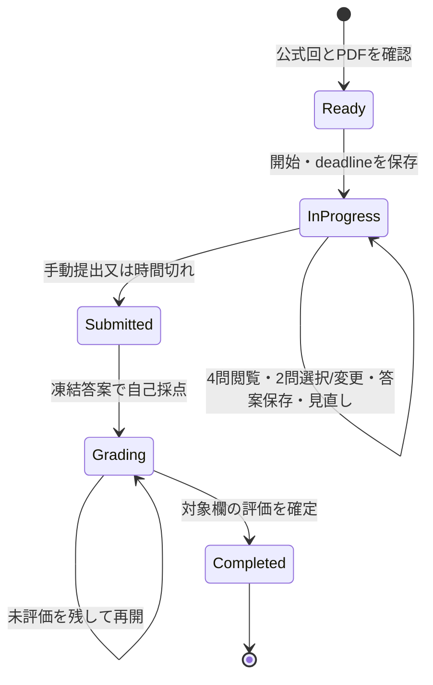

# SC 科目B：既存B-1監査・移行設計

監査日：2026-10-08。対象：この作業開始時のワークツリー（既存の未コミット変更を含む）。

**最終判定は B：既存B-1基盤を利用しつつ大きな改修が必要。** 大問→設問→解答欄、記述答案、自己評価、途中保存、根拠・振り返りは残す。NW教材、NWカテゴリ・関連付け、3問から事前に2問を選ぶ90分模試はSCの有効教材・本番模試から外す。内部ID `b1`、既存ルート、テーブル名は維持し、ユーザー表示を「科目B」とする。

本書と `data/sc-b-categories-draft.json` だけを新規作成する。以下のスキーマ・画面・移行手順は将来の提案であり、今回は教材本文の投入、既存教材、画面、模試、DB、バックアップ、同期、A-1/A-2の変更を行わない。カテゴリ草案は本番から読み込まない。

## 1. 現在のNW B-1構造

### 1.1 監査対象と実際の教材数

| 層 | 確認したファイル | 現状 |
| --- | --- | --- |
| 教材 | `data/b1-cases-2023-2025-ready.json` | schemaVersion 2、9大問、83 questionUnits、152 answerFields |
| 追加教材 | `data/b1-cases-2016-2022-ready.json` | schemaVersion 2、18大問、160 questionUnits、227 answerFields |
| 合計・読込み | `src/data/b1.ts`、`src/data/b1.test.ts` | **27大問・243設問単位・379解答欄**。2016～2019、2021～2025の9年度、各3大問。b1DataVersion=4 |
| 分類・現在性 | `data/b1-categories.json`、`data/b1-relevance.json` | 18カテゴリ。current_core / modern_successor / historical_context / low_current_priority |
| 出典 | `data/b1-source-manifest.json`、`data/b1-source-manifest-2016-2022.json` | NW午後Iの問題・解答・講評・年度ページURL。前者と後者でキー表記も異なる |
| 教材校閲 | `data/b1-phase2-official-review.json`、`src/data/b1OfficialReview.ts`、`reports/b1-*` | 27 caseReviewsを設問ごとに展開。現行検証上243 completed / 0 needs_review。これはNW教材の既存証跡でありSC校閲の証跡にはできない |
| 学習支援 | `src/data/b1LearningSupport.ts`、`src/domain/b1LearningSupport.ts`、`data/b1-failure-causes.json`、`data/b1-a2-topic-aliases.json` | 要求分解・根拠・失点原因・A-2候補を実行時に生成する |
| 演習UI | `src/pages/B1HomePage.tsx`、`B1PracticePage.tsx`、`B1SessionPage.tsx` | 年度→大問開始、training / practical、設問前後移動、回答確定、答案保存、見直し、書き直し |
| 模試UI・集計 | `src/pages/B1MockSelectionPage.tsx`、`src/domain/b1MockExam.ts`、`src/pages/B1ProgressPage.tsx` | 2大問事前選択・90分・提出後に自己採点。回答欄数、未回答、一部入力、見直し、経過時間の集計 |
| 永続化 | `src/database/database.ts`、`types.ts`、`src/features/b1/b1Repository.ts`、`b1LearningSupportRepository.ts`、`b1PreferencesRepository.ts` | SC DB名 sc-dojo、DB version 14。B-1セッションversion 1/2/3の互換処理あり |
| バックアップ | `src/domain/backup.ts`、`src/features/settings/dataManagementRepository.ts` | sc-dojo-backup v6。B-1演習・模試・PDF登録メタ情報・根拠・振り返り・A-2復習・答案試行・設定を含む |
| 同期 | `src/features/sync/b1CloudSync.ts`、`types.ts`、`cloudSyncLocalRepository.ts`、`supabaseCloudSyncGateway.ts` | 通常演習の答案と進捗、reset境界。クラウドscopeは sc:b1.answer / sc:b1.progress / sc:b1.reset |
| PWA | `vite.config.ts`、`src/features/pwa/*`、`scripts/validate-deployment.mjs` | SCキャッシュをNWから分離。アプリ・JSON由来のチャンクはprecache、公式PDFは除外 |
| 試験・検証 | `src/data/b1*.test.ts`、`src/domain/b1*.test.ts`、`src/features/b1/*.test.ts`、`src/pages/B1Flow.test.tsx`、`B1ProgressPage.test.tsx`、`e2e/b1-integration.spec.ts`、`scripts/validate-b1-*.mjs` | 詳細は18章 |

`docs/B1_PACKAGE_README.md` の9大問・83単位は2023～2025パッケージの説明で、現在の総数ではない。`subjectConfigs.b1.questionCount` も83のままで、243単位の実カタログと一致しない。SC移行で固定値を別の固定値に置換せず、カタログから「大問数」「設問数」「欄数」を分けて算出する。

### 1.2 データの対応

```text
caseId: B1-2025-Q1（NWを表す接頭辞・期情報はない）
  year / questionNumber / categoryIds[] / topics[] / estimatedMinutes
  source: exam / sectionAtTime / currentEquivalent / 3種のPDF URL / 年度ページ
  body: fullTextIncluded=false / figuresIncluded=false
  questionUnits[]
    questionId / label / promptSummary / answerConcepts / grading.mode
    sourcePromptLocator: PDFの0始まりページ、印刷ページ、図・表・下線参照
    answerFields[]
      fieldId / label / inputKind / maxLength / acceptedAnswers[]
      orderMatters / expectedCount / notes / legacyAnswerSource?
```

questionUnitは「設問1(1)」などの解答・自己評価単位で、複数の空欄を持てる。旧版の一つの設問を公式設問単位へ分割した `legacyQuestionIds` / `legacyAnswerSource` がある。単に配列をSCへ差し替えると、`migrateB1SessionCatalog` の既存再編成処理や集計が参照する意味が変わる。

本文・図表を同梱せずPDFを正本とする。`promptSummary` は設問要約で、本文を読む代替ではない。10種のinputKind（term、description、multi_select、device_name、number、sequence、cidr、symbol、url_or_fqdn、ip_address）を持つ。

実教材の採点モードは automatic 99単位、concept_assisted_self_grade 131単位、self_grade 13単位。実際のフィールド名は **acceptedAnswers** で、`acceptableAnswers` ではない。JSONには `acceptedAliases` もあるが、正規化後の実行時モデル・採点関数はこれを使っていない。

### 1.3 現在の挙動と不足

- **答案・字数**：`B1AnswerForm` は日本語IMEのcompositionを扱い、HTML maxLength、string.slice、value.lengthを使う。指定欄単位の上限はあるが、Unicode文字の数え方、空白・改行・コードの扱いを試験規則として定義していない。複数欄の答案試行のcharacterCountは合計値。
- **許容・自動判定**：NFKC、空白・句読点・大小文字、数値、IPv4/CIDR表記を正規化。順不同・順序・expectedCountに対応。ただし複数回答のacceptedAnswersをflatMapして一つの期待集合にするため、「複数の許容セット」を表現できない。URL・コード等の大小文字を一律無視する判定はSCでは再検討が必要。
- **自己評価**：correct / partial / incorrect、旧reviewを互換読込み。回答確定スナップショットと評価日時を別保存。concept_assisted_self_gradeは概念を表示するが、現在のフォームに意味の判定やキーワード充足度の自動推定はない。
- **状態**：通常演習 in_progress→completed、模試 in_progress→submitted→completed。提出時は全欄入力済みの設問だけを回答確定する。模試completedにはautomatic以外の全設問の自己評価が必要。
- **模試**：official_yearは同一年の3大問から2問を事前選択。他にcurrent_focus / all_years / legacy_reading。保存するcaseIds・unitIdsは選択した2問のみで、提示した候補4問や選択変更履歴のモデルはない。時限はRepositoryとsubject config双方に90分、modeはmock90。
- **タイマー・保存**：deadlineAt−Date.now()で表示し、1秒更新・focus時の再確認・再読み込み時の期限チェック。答案は保存キュー経由でIndexedDBへ保存し、提出はキューを待つ。端末時計の変更・複数タブ・期限直前のIME入力・保存失敗後の提出はSC用の受入試験が必要。
- **通常演習・復習**：年度別・大問別と現在性のフィルターはある。categoryIdsは表示用で、B-1演習一覧に分野・未実施・お気に入りの絞込みUIはない。進捗は未確定・partial・incorrect・手動見直しを復習対象にし、対象設問から大問全体の演習を開始してその位置に移動する。
- **成績**：最新の設問状態による回答確定率・自己評価数、年度別・大問別進捗、模試履歴、失点原因、根拠未記録率、書き直し等。Bのカテゴリ別自己評価集計は未実装。根拠未記録率の母数にセッション内の未着手設問も含む。「書き直し改善率」は書き直しがcorrectになった割合、「A2復習後改善率」はremediationCompletedBefore付き書き直しの割合で、前後の評価差を比較していない。
- **学習支援・根拠**：要求分解はNW語彙の正規表現から汎用文を生成。officialEvidenceも設問掲載ページ・最初の図表参照から汎用summary/reasonを作る。各解答の本当の本文根拠を人が記述したものではない。校閲completedの継承をSCの根拠妥当性の保証にしない。
- **A-2連動**：ケース全体のNWトピック別名→A-2のsubcategory/本文部分一致→先頭3問。3問未満ならnot_applicable。純粋推薦関数は知識不足/計算ミスでのみ作動し、教材側triggerFailureCauseIdsを直接採用していない。現在は参照先A-2が正式SC240問になっているため、現状を厳密に「NW B-1→NW A-2」とは呼べない。今回の静的再計算では候補が3件以上になる9大問/83設問のみlinked相当。NWトピックに偶然SC問題が一致しても設問ごとの妥当性は保証されない。
- **PDF登録**：b1PdfFilesの主キーはyear。ファイル拡張子/MIME、空ファイルを確認してBlobを端末に保存するが、試験・期・区分・公式ファイル内容の一致検証はない。オンラインiframe/別タブ、登録済みBlob URLに対応。ローカルBlobの表示URLには現在ページfragmentが付かず、外部iframeのfragmentは印刷ページを用いている。
- **履歴分離**：NWアプリDB・クラウドscopeからSCアプリを分離済み。しかしSCアプリ内でNW内容を学習したB-1履歴のexamCode、source_id、content_hash、dataset_version、manifestはない。subjectId=b1だけでは教材の試験区分を特定できない。
- **バックアップ・同期**：全B-1ローカル履歴はバックアップ対象。PDF実体は対象外。同期対象は通常演習の答案・確定状態・自己評価・見直し・支援開示・進捗とresetであり、模試、PDF Blob、根拠、振り返り、答案試行実体、A-2復習進捗、B-1設定を全面同期する機能はない。attemptIdsは送るが試行本文の全面同期ではない。

## 2. KEEP / MODIFY / REMOVE / NEW_REQUIRED一覧

KEEPは処理・概念をそのまま使えるもの。識別情報を添える永続レコードや教材内容は別行のMODIFYとする。REMOVEは**SCの有効教材・新規動線から外す**意味であり、NW原本・退避履歴・互換読込みの削除ではない。

| 対象 | 判定 | SCでの扱い・主な実装箇所 |
| --- | --- | --- |
| case→questionUnit→answerFieldの三層 | KEEP | 大問→設問→欄に対応。`src/data/b1.ts` |
| 複数欄、順不同、順序、回答数 | KEEP | 同じ入力概念。許容セットの表現は別途MODIFY |
| 本文・図・表・下線の出典参照という概念 | KEEP | ページ番号の区別・documentIdは追加 |
| string答案・IME対応、確定スナップショット | KEEP | 切り捨て・字数規則と期限処理はMODIFY |
| correct / partial / incorrect | KEEP | IPA点数との換算を行わず自己評価として使う |
| 設問単位の見直し・前後移動 | KEEP | 大問4問へのナビゲーションを追加 |
| 根拠・振り返り・書き直しの学習サイクル | KEEP | レコードの識別・本文根拠をMODIFY |
| training / practicalの開示方針 | KEEP | SC固有の支援内容を別データで著作する |
| 年度別・大問別の演習 | MODIFY | 年度＋期＋原区分をキー・表示に加える |
| NW教材JSON、NW出典、公式解答・講評 | REMOVE | SC教材への上書き・自動変換をしない |
| NWカテゴリ18件の割当 | REMOVE | SC草案12分類へ独立して著作する |
| NW現在性ラベルの個別判定 | REMOVE | ラベルの概念は流用、SC内容の判定を再作成 |
| case/sourceのモデル・loader | MODIFY | examCode、term、section、examSetId、identity等 |
| 答案入力・字数制限 | MODIFY | 欄ごとの計数規則、コード等、超過表示、期限境界 |
| acceptedAnswers、自動正規化 | MODIFY | 公式・編集許容例の分離、欄ごとの比較規則 |
| 採点状態・結果 | MODIFY | 提出答案の凍結、未回答と未評価、欄別評価 |
| 2大問選択という制約 | KEEP | SCも解答2問。選択する時点・変更・保存はMODIFY |
| 3問→2問事前選択・90分・mock90の新規利用 | REMOVE | 旧履歴読込み専用で保存。SC本番に使わない |
| 締切方式・保存キュー | MODIFY | 150分、選択時間を含む、未保存・多重提出対策 |
| 模試一覧・提出・自己採点UI | MODIFY | 同一回4問を提示、2問提出、結果を分離 |
| current_focus等で異年混在する既存模試 | MODIFY | SCの追加練習として表示。本番模試と分ける |
| NW要求分解の機器/通信/経路/帯域のテンプレート | REMOVE | 一律NW支援を外し設問別SC支援へ |
| IP・CIDR・URL・sequence等の汎用入力型 | KEEP | SC設問が必要とする場合に利用。NW専用とは断定しない |
| NW向け失点原因の文言・適用正規表現 | MODIFY | SC原因体系、内容別の任意表示へ |
| 根拠記録 | MODIFY | 引用位置・事実・推論・答案要素を分離、欄にも紐付け |
| officialEvidenceの自動生成 | MODIFY | 実際の本文根拠を著作・校閲。汎用文にcompletedを付けない |
| NW A-2 topic aliases・先頭3問抽出 | REMOVE | SC語彙・設問別校閲マップへ |
| A-2へ移動・進捗・元設問へ戻る基盤 | MODIFY | SC A-2 identityと復習理由、終了後再答案へ |
| 成績・履歴・復習対象判定 | MODIFY | SC identityで絞り、期・分野別集計、指標定義を修正 |
| 公式PDFをユーザーが端末登録する方式 | KEEP | PDF実体を外部送信しない運用 |
| PDF保存キー・表示・命名 | MODIFY | 年度だけでなくdocumentId。物理ページ位置を使う |
| DB・バックアップ・Supabase同期 | MODIFY | b1を維持し教材identity・manifest・退避・版境界を追加 |
| SCアプリのDB/cache/scope独立化 | KEEP | sc-dojo / sc: を維持。教材識別の代替にはしない |
| PWAシェル・ローカル保存・更新確認 | KEEP | オフライン条件と試験中更新延期の検証を追加 |
| NW固定件数・年・90分・文字列検査 | MODIFY | NW互換検査を保持しSC用データ検証を別に追加 |
| 4問の提示集合・選択2問・選択変更履歴 | NEW_REQUIRED | 未選択答案保全、選択状態の原子保存 |
| 同年度の春/秋・旧I/II/現行の共存 | NEW_REQUIRED | examSetId / term / originalSection |
| 苦手・未実施・お気に入り・分野フィルター | NEW_REQUIRED | B-1専用のbookmarkと選択条件・状態定義 |
| SC教材manifest・旧NW由来B履歴退避 | NEW_REQUIRED | 検証・バックアップ・同期のすべてに境界を持つ |
| 公式解答の訂正・不成立設問 | NEW_REQUIRED | 採点対象外・理由・更新版・検証可能な出典 |
| SCのログ/コード/認証/攻撃/リスク支援 | NEW_REQUIRED | 手動著作、模試提出前は非表示 |

## 3. SC科目Bとの差分

### 3.1 2026年度を固定する

2026年度の対象は**記述式、150分、4問出題・2問解答**。[IPA SC試験区分](https://www.ipa.go.jp/shiken/kubun/sc.html)で確認した。現行構成は2023年秋からの統合午後試験で、旧午後Iは90分・3問中2問、旧午後IIは120分・2問中1問。[IPA出題構成変更](https://www.ipa.go.jp/shiken/syllabus/henkou/2022/20221220.html)

2026年度はCBT移行年度として扱う。2027年度以降の新試験制度は本設計に含めない。「2026年度後期」が暦年2027年に実施される場合も年度と制度を混同しない。試験名・対象年度とルールID `sc-b-2026` を明示する。[IPA CBT実施案内](https://www.ipa.go.jp/shiken/2026/ap_koudo_sc-cbt.html)

### 3.2 NW固有要素の仕分け

| 現在の要素 | そのまま残せない部分 | 残せる部分 |
| --- | --- | --- |
| 通信方向 | `/通信\|経路…/` 等で常に「送信元→宛先」を支援する生成ロジック | SCの攻撃通信・ログ・認証要求/応答で必要な場合の方向欄 |
| 経路 | OSPF/BGP収束、経路制御・ルータ更改を主眼とする教材・routeの推定 | 攻撃経路、信頼境界、FW通過の事実整理、sequence入力 |
| 帯域 | 帯域語彙から計算問題と失点原因を推定するルール | DDoSや可用性に数値計算が必要な設問のみ計算型 |
| IPアドレス | IP/CIDRが常にNW試験のアドレス設計を意味する分類 | アクセス制御・送信元識別・ログ照合用の入力と参照 |
| ネットワーク構成 | LAN/冗長化/QoSを中心にした支援・カテゴリ | SCの通信図・OT/クラウド境界・セグメント・権限図 |
| 失点原因 | プロトコル・機器・経路中心の説明と正規表現による適用 | 知識、根拠、条件、図表、表現、時間という汎用観点 |
| NW A-2トピック | OSPF、VRRP、STP、LAG等の別名辞書・先頭一致抽出 | 復習を開始・完了してBへ戻る導線 |
| NWカテゴリ | routing_redundancy、nat_addressing、bgp_internet_routing、multicast、qos_voice等のIDと割当 | 複数カテゴリを大問に付ける構造 |
| NW PDF名 | `_nw_pm1_`、yearだけの出典・登録判定 | 公式URLをmanifestに保存する方針 |
| B-1名称 | source.currentEquivalentの科目B-1、古い文書・モード説明 | 内部 `b1`。画面は既に多数が「科目B」だが内容はNW |
| 90分 | config、createMock、UI、mock90、検証・テスト前提 | 旧NW履歴の元deadlineを維持する互換処理 |
| 2大問選択 | 3候補から試験前に確定して選択2問しか保存しないモデル | 「提出対象は2問」はSCも維持 |

SCでもネットワーク技術を扱う。IP・通信方向そのものを削除するのではなく、SCの設問に適用を限定する。

## 4. SC科目B推奨データ構造

### 4.1 最小変更の方針

三層は維持する。大問を二つの長文ケースへ分解したり、四択Question型へ変換しない。追加する中心は**試験回、教材identity、欄別採点資料、本文根拠、表示アセットの識別**。既存NWローダーは互換読込み用として残し、将来 `sc-b-cases.json` と専用adapterを追加する。本番カタログは片方だけを有効にする。

| 単位 | 追加・変更案 | 理由 |
| --- | --- | --- |
| payload | schemaVersion、examCode=SC、subjectId=b1、dataset_version=sc-b-v1、status、fingerprint、sources、examSets | 正式/草案・教材版・試験構成を識別 |
| examSet | examSetId、year、term、originalSection=pm/pm1/pm2、caseIds、presentedCount、selectedCount、durationSeconds、mockEligibility | 春秋/旧区分を同一年に共存。現行回は4件・2件・9000秒 |
| case | caseId、source_id、content_hash、examSetId、examCode、year、term、questionNumber、originalSection、primaryCategoryId、categoryIds、topics | NWのB1-YYYY-Qnを再利用しない |
| source | question/answer/commentaryDocumentId、公式URL、取得日・SHA-256・版・ページ数・訂正履歴 | PDFの同一性、訂正版の追跡 |
| body | mode=official_pdf_reference（v1）、将来structured、blocks/assetsの任意拡張 | 固定false型を将来一般化。v1はPDF参照で実現 |
| questionUnit | questionId、source_id、content_hash、公式設問ラベル、categoryIds、requiredKnowledgeTags、sourcePromptLocator、review | 設問ごとの弱点・A-2連動。U01等の並びは永続出典IDの代替にしない |
| answerField | 現行inputKind・maxLength・expectedCount・orderMatters + gradingMaterial・comparisonPolicy・scoringDisposition | officialAnswerと編集例を分ける。コード/ログも既存textで始められる |
| guidance | requirements、officialEvidence、supportKinds、failureCauseIds、a2Links、help_hash | 本文根拠と補助内容を教材版から追跡 |

識別例（**形式例で、問題本文・解答例は含めない**）：

```text
examSetId   SC-2025-FALL-PM
caseId      SC-B-2025-FALL-PM-Q01
source_id   SC-2025-FALL-PM-Q01
questionId  SC-B-2025-FALL-PM-Q01-S2-1
fieldId     c（公式欄ラベルに対応。複数表の同名欄は局所的に区別）
documentId  SC-2025-FALL-PM-QUESTION-<公式PDF版のhash>
```

`source_id`には試験SC・年度・期・原区分・大問・公式設問経路を含める。旧午後I/IIをPMへ偽装しない。データの配列順序・画面の呼称を変えてもIDは維持する。2020年の期は公式名「10月試験」を保持し、内部termとの対応を明記する。

`sourcePromptLocator` のpdfPageZeroBasedとprintedPageは別々に保持する。配列ページ範囲 `[start,end]` とページ列挙を混同しないため、caseは明示的 `pageRange: {startZeroBased,endZeroBased}`、設問はpages配列を推奨。表の行列、コード行、ログ時刻、段落IDは任意locatorとして足す。

### 4.2 採点資料の構造

各欄のgradingMaterialを次の4要素に分離する。

| 要素 | 提案 | 出典・扱い |
| --- | --- | --- |
| officialAnswers | 複数の公式例、公式の注記、answerDocumentId・ページ・表位置 | IPA公式と表示。複数欄で一つの意味を作る場合はunit共通rubricも持つ |
| acceptableAnswers | 編集部が校閲した言換え例と理由、reviewStatus | 「学習用の許容表現例」。公式採点基準とは表示しない |
| requiredConcepts / keywords | 主体・動作・対象・条件・効果などの観点、同義語候補 | キーワード一致は自己評価補助に限定 |
| selfGradePoints | correct/partial/incorrectの目安、よくある不足、採点メモ | 数値配点を推測しない。正しい別表現を排除しない |

既存acceptedAnswersはautomaticの限定解答集合にだけ移行する。公式/編集例の出典を確認せずすべてofficialAnswersに移さない。順不同の複数候補は `acceptedAnswerSets: string[][]` のように**許容セットごとの境界**を持つ。記号・数値・用語の限定判定と、文章の意味を比較する自己採点を分離する。

### 4.3 教材レビューと不成立設問

公式問題・解答・講評の3資料を照合し、欄数、文字数、選択数、ページ、公式ラベル、複数解答注記、根拠、A-2リンク、解答漏出を確認する。caseレビューの単純展開だけで設問をcompletedにしない。初期はdraft→reviewed→active、不明点はneeds_reviewとして非公開にする。

2024春問4には公式解答上で設問不成立の扱いがあるため、`scoringDisposition: normal | excluded`、理由・公式注記・訂正版を持つ。excluded欄も原文対応は保ち、未回答率や自己評価率の母数から除外し「公式資料による対象外」と表示する。[IPA 2024春解答例](https://www.ipa.go.jp/shiken/mondai-kaiotu/m42obm000000afqx-att/2024r06h_sc_pm_ans.pdf)

## 5. 推奨カテゴリ

### 5.1 公式過去問20大問の分布

現行形式5回すべての公式解答PDFの**出題趣旨・解答の論点**を確認し、主分類を一つ、副分類を複数付けた。以下の題材は本監査の短い要約で、公式カテゴリ名や全文の転記ではない。分類は設計判断で、将来の設問単位の校閲で調整する。問数や試験構成の確認と、全文・全欄の教材化レビューは別工程。

| 試験回・公式資料 | 問1 | 問2 | 問3 | 問4 |
| --- | --- | --- | --- | --- |
| [2023秋](https://www.ipa.go.jp/shiken/mondai-kaiotu/ps6vr70000010d6y-att/2023r05a_sc_pm_ans.pdf) | Web脆弱性・コード読解：Web | 無線LANの対策見直し：ネットワーク | CIサービスの侵害対応：インシデント | 委託業務のリスク評価：リスク |
| [2024春](https://www.ipa.go.jp/shiken/mondai-kaiotu/m42obm000000afqx-att/2024r06h_sc_pm_ans.pdf) | APIの脆弱性と防御：Web | VPN・DDoSへの対策：ネットワーク | Web脆弱性診断：Web | Java/RDBMSの安全な実装：セキュア開発 |
| [2024秋](https://www.ipa.go.jp/shiken/mondai-kaiotu/m42obm000000afqx-att/2024r06a_sc_pm_ans.pdf) | 端末侵害のログ解析：ログ | メールサービス・DMARC：ネットワーク | Webスキミングの調査：Web | Web/API診断と改善：脆弱性管理 |
| [2025春](https://www.ipa.go.jp/shiken/mondai-kaiotu/nl10bi0000009lh8-att/2025r07h_sc_pm_ans.pdf) | 開発企業のサプライチェーン対策：情報セキュリティ管理 | 脆弱性の深刻度・対応優先度：脆弱性管理 | スマートフォンアプリの安全性：セキュア開発 | 公開IT資産の把握と脆弱性：脆弱性管理 |
| [2025秋](https://www.ipa.go.jp/shiken/mondai-kaiotu/nl10bi0000009lh8-att/2025r07a_sc_pm_ans.pdf) | Webの設計・実装不備：Web | 暗号鍵の管理と処理：暗号 | リモートワークのVPN導入：ネットワーク | サプライチェーン/製造環境の対策：リスク |

### 5.2 草案12分類と境界

| categoryId | 表示名 | 主分類20大問での件数 | 境界・主要タグ |
| --- | --- | ---: | --- |
| sc_b_auth_access | 認証・認可 | 0 | 主体、資格情報、セッション、MFA、権限。Web/ネットワーク等の副分類で使う |
| sc_b_crypto_pki | 暗号・PKI | 1 | 鍵、署名、証明書、ハッシュ。認証の利用目的とは分ける |
| sc_b_web_security | Web・APIセキュリティ | 5 | HTTP、ブラウザ、API、Web固有の攻撃・防御 |
| sc_b_network_security | ネットワーク・メールセキュリティ | 4 | FW、VPN、無線LAN、DNS、DMARC。帯域/経路設計は主題にしない |
| sc_b_attack_malware | 攻撃・マルウェア | 0 | 攻撃成立条件、侵入、横展開、窃取。大半のケースに横断する副分類 |
| sc_b_incident_response | インシデント対応 | 1 | 調査、影響範囲、封じ込め、復旧、再発防止 |
| sc_b_logs_monitoring | ログ・監視 | 1 | 時系列、主体、成功/失敗、相関、検知・誤検知 |
| sc_b_cloud_security | クラウドセキュリティ | 0 | SaaS/CI、共有責任、IAM、メタデータ、外部連携。利用基盤だけならタグ |
| sc_b_secure_development | セキュア開発・モバイル | 2 | コード、設計、レビュー、秘密情報、開発工程、モバイルアプリ |
| sc_b_vulnerability_management | 脆弱性・IT資産管理 | 3 | 診断、CVSS/EPSS、資産把握、優先度、修正・検証 |
| sc_b_risk_management | リスク管理 | 2 | 資産・脅威・影響・リスク評価と対応、対策の理由 |
| sc_b_security_governance | 情報セキュリティ管理 | 1 | 責任、規程、委託、教育、管理体制、サプライチェーン |

合計20。主分類0件は範囲不要という意味ではない。認証・攻撃・クラウドは副分類として学習価値が大きい。サプライチェーン、OT/制御、モバイル、メール、フォレンジック等はtopicタグで扱い、少数のため主分類を増やしすぎない。主分類の集計は合計20、副分類の「関連大問数」は重複を許すと明記する。

Webと開発の境界は「HTTP/ブラウザ/APIの動作判断」か「コード・開発工程の改善判断」か、脆弱性管理とWebの境界は「診断・優先度・ライフサイクル」か「脆弱性の成立機構」かで決める。旧問を追加する際に分類を再監査し、既存IDを再利用して意味を変えない。草案JSONに20大問の分類根拠と実SC A-2カテゴリへの候補対応を記録した。

## 6. 通常演習設計

既存B1PracticePageの年度見出し・大問カード、training/practical、B1SessionPageの答案・PDF・確定・再答案は流用する。**検索・絞込み・期の表示・設問単独キュー・お気に入り保存は追加が必要**。

| 動線 | 提案 | 現状からの差分 |
| --- | --- | --- |
| 年度別 | 年度→春/秋（将来前期/後期）→原区分→大問 | yearだけの一覧をexamSetへ |
| 大問別 | 1大問を通して解く。設問一覧に入力/未入力/確定/自己評価/見直しを併記 | 既存入力workspaceを使用 |
| 分野別 | case/設問の複数カテゴリ・topicで絞り、ヒット設問と本文閲覧を維持 | 表示用カテゴリを検索対象へ |
| 苦手問題 | 最新の評価がpartial/incorrect、任意見直し、同じ失点原因が続くもの | 進捗の復習対象を流用。評価母数が少ない問題は断定しない |
| 未実施 | 現教材identityに答案試行・確定・提出が一度もない設問 | 「未確定」「未評価」と別に定義 |
| お気に入り | 大問と設問をbookmarkとして保存 | B用テーブル/バックアップを追加。見直しと兼用しない |
| 設問だけ復習 | 任意unitIdsの練習キュー。ただし元大問本文/図表は全体を開ける | createReviewPracticeの大問開始+位置移動を拡張 |

フィルターはAND、複数カテゴリの選択内はORを原則にする。0件は条件解除を案内。旧午後I/IIと現在性低の問題は任意で含め、既定は現行形式の教材。通常演習では期限なし、参考時間75分/大問は目安で、150分を半分に強制配分しない。下書きを途中保存し、評価を見るには回答確定（白紙確定を含む明示操作）を必要とする。ヒント開示を記録して実践成績と比較できるようにする。

## 7. 本番模試設計

### 7.1 提示4問と解答2問を分離

本番模試のルールは `presentedCount=4, selectedCount=2, durationSeconds=9000`。同一examSetの現行形式4問を一つの組として用意し、欠けた回・旧午後I/IIは本番候補に出さない。初期版は公式回の5セットを優先し、異年混合4問は別の「追加模試」として後段にする。

開始前に年度・期・150分・4問から2問・PDF登録状況・保存先を説明する。**開始後に4問の本文/設問を閲覧し、選択検討も150分に含める。** 試験開始前の画面に解答、出題趣旨、解説的な要約、苦手推薦、ヒントを載せない。開始前に題材を熟読できる既存選択画面をそのまま本番へ転用しない。

### 7.2 状態と操作



保存statusは既存のin_progress/submitted/completedを維持し、Gradingはsubmitted内の表示状態にできる。modeは将来mock150を追加し、mock90は旧履歴専用。状態保存のversionを明示的に上げる。

| 操作 | 設計 |
| --- | --- |
| 4問一覧 | 問1～4、原題材、選択/未選択、回答欄充足数、見直し数。正誤色や編集済み攻略情報なし |
| 2問選択 | selectedCaseIds最大2。選択後は大問タブからいつでも一覧へ戻れる |
| 選択変更 | 2問選択済みなら入替ダイアログで対象を指定。外した大問の下書きは保全し、戻すと復元。選択時間・deadlineは延長しない |
| 途中保存 | 提示4問、選択2問、4問分の下書き、位置、見直し、選択変更の時刻を原子的に保存。DB保存完了表示と失敗時再試行を用意 |
| タイマー | startedAt/deadlineAt基準。閉じている間も進む。表示間隔は計時の正本ではない。残り10/5/1分は静かな表示 |
| 見直し | 設問単位のフラグと大問別件数、未回答・一部入力を一覧から移動可能にする |
| 手動提出 | 選択がちょうど2問であること、選択問の空欄/一部入力/見直し/保存状態を示す。白紙を含んでも提出可能 |
| 提出確定 | 保存キュー成功を確認し、選択2問と対象答案を凍結。非選択答案は提出対象外として保全し、結果の母数に含めない |
| 時間切れ | 0で編集を止め、保存済みの選択・答案で一度だけ提出。閉じていた場合は再開時にdeadlineで判定。未評価のまま保存する |
| 自己採点 | 提出後に公式解答、編集許容例、観点を表示。後で再開可能。提出答案は書き換えず再答案を別試行へ |
| 結果 | 2問の評価件数、未回答、未評価、除外欄、見直し、時間、失点原因、根拠、分野別の自己評価。IPAの得点/合否を推定しない |

時間切れ時に選択が2問未満なら、選択済み分だけを記録し残りを「解答大問未選択」とする。アプリが勝手に下書きのある問題を選ばない。selectedCount不足・形式未達を結果に表示し、自己採点して学習履歴として残せる。submittedCaseIdsは0～2件を許し、**正常な手動提出は2件必須、timeoutのみ不足を許可**する。

### 7.3 保存モデル案

```text
subjectId=b1 / examCode=SC / datasetIdentity / sessionVersion
mode=mock150 / ruleId=sc-b-2026 / examSetId
presentedCaseIds[4] / selectedCaseIds[0..2] / selectionEvents[]
answers（提示4問の全unit/fieldに対する下書き）
currentCaseId / currentQuestionId / perCaseViewPositions
reviewQuestionIds / startedAt / deadlineAt / updatedAt
status / submittedAt / submissionReason
submissionSnapshot: submittedCaseIds / unitIds / answers / identity / missingSelectionCount
grades: 欄別自己評価・メモ・評価日時（凍結答案に対応）
```

currentIndexだけに依存せず、選択変更で位置がずれる問題を避ける。unitIdsは現在の解答2問の表示用に導出できるが、提出後の正本はsnapshotとする。

保存失敗をcatchして終了したキューを単に待つだけで提出成功としない。最後の保存済みrevisionと提出対象revisionを確認し、同一sessionの多重タブ更新はrevision検査/単一編集者制御で防ぐ。期限時にメモリ上だけの答案が残った場合は回復用下書きとして保全・明示し、保存済み提出答案に黙って混ぜない。IME未確定文字は最後に確認された入力を正本として凍結し、境界をE2Eで検証する。

時計操作を完全防止する監督システムは作らない。異常な時刻移動は通知・記録し、期限延長やリロードによるリセットをしない。通常練習の一時停止は別モードに限定する。

## 8. 学習支援設計

現在の要求パネル、提出後パネル、表示を制御するmodeは再利用できる。内容は正規表現のNWテンプレートから**SC設問別に校閲した補助データ**へ作り直す。AI/APIは利用しない。

| 支援 | 学習する判断 | 表示する要素 |
| --- | --- | --- |
| 設問要求 | 誰について、何を、いくつ、どの形式で答えるか | 主体、対象、条件、回答数、文字数、理由/対策/手順等 |
| 本文根拠 | 本文の事実と一般知識を区別する | 本文/図表/ログ/コードの位置、事実→推論→答案要素 |
| 攻撃・脅威・脆弱性・対策 | 手法と原因、被害と防御を混同しない | 攻撃主体・前提・弱点・手順・影響・対策・残留リスク |
| ログ | 時系列・送信元・主体・操作・成功/失敗を読み取る | 時刻、アカウント、機器、イベント、比較対象、判断根拠 |
| 認証・認可 | 誰が何を検証し、何の操作を許可するか | 主体、資格情報、トークン、検証者、権限、順序、有効期限 |
| 暗号処理 | 暗号化/署名/検証・鍵の所有者を区別する | 処理目的、入力、鍵、主体、出力、機密性/完全性の効果 |
| インシデント | 調査・証拠保全・封じ込め・復旧の目的を考える | 時系列、影響、根拠、実施主体、優先順位、再発防止 |
| 設計上の問題 | 信頼境界・権限・入力/出力・秘密の扱いを検討する | 現設計、満たす要件、問題点、対策の位置、効果 |
| リスク/管理 | 技術対策を業務・資産・責任へ結び付ける | 資産、脅威、影響、対応、担当、運用・確認 |

trainingでは空の整理枠と段階ヒント、practicalでは要求だけ任意開示、提出後は校閲した具体例と根拠を表示。本番模試は解答・キーワード・解説・公式根拠・A-2推薦・編集ヒントを提出前に表示しない。設問要約・field.notes・grading.cautionも漏出レビュー対象とし、答案前view modelからanswerConcepts等も除く（現モデルはspreadによりanswerConceptsが残る）。クライアント内の教材を秘密にする仕組みではなく、学習動線として漏出を防ぐ。

## 9. 根拠記録

**MODIFY。SC科目Bの中心的な学習機能として採用する。** 現在の複数記録、sessionId/questionId、sourceType、印刷ページ、location、note、追加/編集/削除は活用できる。

追加はfieldIds（任意）、datasetIdentity、documentId、pdfPageZeroBased/printedPage、paragraph/figure/table/log/codeのlocator、fact（読み取った事実）、reasoning（なぜ答案につながるか）、answerElement（対応する答案の部分）。自由メモは維持し、全項目の必須入力は求めない。本文根拠と一般知識をsourceTypeで明確に分ける。

通常演習では答案前に利用者自身が根拠を記録できる。確定後に公式由来の根拠と自分の根拠を比較し、見落とし/誤読/推論不足を振り返る。公式根拠は設問掲載ページだけを示す現行自動生成を置換し、実際の該当段落・図表行等に人が対応させる。

本番模試では編集部の根拠を非表示とし、任意の自由メモ/参照位置だけを使える。根拠なしでも提出可能。根拠未記録率の母数は実際に回答/提出した対象設問（除外欄・未選択大問を除く）にし、「根拠不足だから不正解」という自動判断をしない。

## 10. 失点原因

SC版は以下を標準候補とし、1～3個程度を選べる。SC版の定義には版を付ける。旧NW IDを黙って違う意味に置換せず、旧記録は旧定義で表示する。

| 提案ID | 表示名 | 区別する観点 |
| --- | --- | --- |
| sc_b_requirement_misread | 設問要求の読み違い | 理由/対策/対象/回答数等の要求そのもの |
| sc_b_evidence_missed | 本文根拠の見落とし | 根拠を見つけていない |
| sc_b_evidence_misread | 本文・図表・ログの読み違い | 見つけた事実を誤って解釈 |
| sc_b_knowledge_gap | 技術知識不足 | 仕組み・前提知識の不足 |
| sc_b_attack_vulnerability_confusion | 攻撃・脅威・脆弱性の混同 | 手法、原因、被害の区別 |
| sc_b_actor_scope_confusion | 主体・対象の取り違え | 攻撃者/利用者/管理者、端末/サービス、移行前後 |
| sc_b_auth_access_confusion | 認証・認可の混同 | 本人確認、トークン検証、操作権限 |
| sc_b_direction_sequence_error | 通信方向・処理順の誤認 | 必要な設問のみ表示。認証応答や攻撃経路を含む |
| sc_b_control_effect_mismatch | 対策と効果の不一致 | 原因に効かない対策、因果関係の不足 |
| sc_b_missing_answer_element | 必要要素・用語の不足 | 主体/対象/条件/効果/用語の不足（字数が短いだけでは該当しない） |
| sc_b_wording_length | 表現・字数条件 | 曖昧、主語欠落、指定文字数超過、記述形式違反 |
| sc_b_time_shortage | 時間不足 | 選択・読解・記述・見直しの配分 |

「字数不足」は必要要素が抜けた場合の補助タグにし、上限まで書くことを正解条件にしない。計算ミス・単位・桁は数値設問の任意タグとして追加可能。失点原因を正規表現で機械的に限定しない。学習者が原因不明なら未分析として保存でき、採点完了を妨げない。

旧knowledge_gap、evidence_missed、time_management等の概念は継承できるが、退避履歴は変換しない。新しいSC設問にNW traffic_directionを自動付与せず、SC設問に適した候補を著作する。

## 11. A-2復習連動

**MODIFY。SC科目B→正式SC A-2 v1（240問）へつなぐ。A-2本体は変更しない。** 現在の正式JSONにはcategory_id / subcategory_id / related_terms / source_id / content_hashがある。大分類実数は33/35/10/31/46/36/14/14/12/9で、190通常演習+25+25模試の構成。

| SC Bの弱点 | 実在するSC A-2カテゴリの候補 |
| --- | --- |
| 攻撃成立、マルウェア | sc_security_threats、sc_security_assessment_controls |
| 認証、署名、鍵、PKI | sc_crypto_auth_pki、sc_security_implementation |
| Web/API・安全なコード | sc_security_implementation、sc_system_development、sc_security_threats |
| VPN/FW/DNS/メール | sc_security_implementation、sc_networks |
| クラウド | sc_security_implementation等から責任共有/IAM/関連用語を確認（専用A-2大分類はない） |
| 脆弱性/インシデント/ログ | sc_security_assessment_controls、sc_security_implementation、sc_security_threats |
| リスク・管理・監査 | sc_security_management、sc_system_audit、必要時sc_development_service_management |

カテゴリ対応だけで自動推薦しない。設問のrequiredKnowledgeTags→SC同義語辞書→related_terms/subcategory_idの候補を作り、人が個別code/source_id/content_hashを校閲してB側リンク表へ保存する。本文部分一致だけ・大問のtopicだけでは不十分。候補不足なら1～2問を推薦してよく、0問はnot_applicableと理由を出す。

知識不足、攻撃/認証の混同、対策の意味不足など**知識が原因**なら推薦。本文見落とし・主体誤認・表現・時間だけなら本文再読/書き直しを優先する。SCのtriggerFailureCauseIdsを推薦関数の入力として用い、固定したNWトリガーに依存しない。

復習は3～5問を上限目安に、直接リンク・誤答/未実施・安定順序・code重複なしで選ぶ。既定候補はcategory_drillの190問から選び、固定模試の未学習を保護する（模試側の問題を使う必要があれば利用者が選べる）。A-2解答履歴は通常のA-2保存を使い、B側にoriginSession/Question、弱点、リンク理由、A-2 identity・完了状態を残す。復習後に元のB設問へ戻って再答案を作る。「A-2完了率」と「Bの自己評価が改善した割合」を別指標にする。

将来A-2が改版されたらsource_id/content_hash一致を確認し、未完了の関連付けを再校閲する。codeだけ同じだから復習完了として流用しない。

## 12. 自己採点

三段階は**KEEP**、資料と評価単位は**MODIFY**。表示は「正解相当」「部分的にできた」「復習が必要」等で自己評価と分かるものにする。AI自動採点は対象外。

入力状態（未入力/一部入力/全欄入力）、提出/確定状態、評価状態（未評価/correct/partial/incorrect/対象外）を別に保存する。未入力を未評価と混同しない。白紙欄は「未回答」として記録し、自己評価の進捗を進められるようincorrect相当を明示する。部分点の比率や公式の設問配点を推定しない。

複数欄のunitには欄別自己評価とメモを加え、unit全体の判定は欄の内訳から表示する。公式例・許容例・必須観点を見比べ、主体・条件・動作・効果を満たすか自分で判断する。キーワード検出を足すなら「見つかった語/確認が必要な観点」という補助だけに留め、文章の意味を採点しない。

提出snapshotを固定し、評価変更日時・採点資料版を残す。再答案は別attempt。未評価が残る結果を仮結果として保存でき、全対象欄を評価した時点でcompleted。結果は欄/設問ごとの自己評価分布と完了率を中心にし、数値得点や60点合否へ換算しない。

## 13. PDF

### 13.1 流用可能な方式と必要変更

公式URL参照＋利用者による端末登録＋IndexedDB Blobという方式は使える。v1はこの方式を推奨し、問題全文・図表のアプリ収録は別フェーズとする。登録済み問題PDFがあればオフライン演習・模試が成立し、未登録では**本文が読めない**ので開始前に具体的に案内する。自己採点に必要な公式例は校閲済み教材データへ収録し、外部PDFだけに依存させない。

yearキーは必ず変更する。documentId（SC、年度、期、pm/pm1/pm2、question/answer/commentary、公式版）で登録し、同一冊子を4大問で共有する。登録メタにURL、公式想定ファイル名、ページ数、sha256、登録日時、確認状態を持つ。拡張子だけでは公式一致と認定しない。一致hashを確認できないものは未検証として扱い、試験/期/区分の確認を求める。

問題PDF、解答PDF、講評PDFはdocumentKindを区別。本番提出前に解答/講評をアプリ内で開く導線を出さない。v1では問題PDFの登録を必須候補とし、解答/講評の端末登録は任意。容量不足・破損・未検証・削除後は日本語で再登録を案内する。

物理PDFページは `pdfPageZeroBased+1` で#pageへ、印刷ページは案内用。2024春の公式問題PDFを実際に描画し、表紙の4問/2問/150分と、問4本文の**PDF35枚目=印刷34ページ**を確認した。両者が一致すると仮定できない。ローカルBlobにもページfragmentを付け、ブラウザが無視する場合の手動ページ指定/別タブを用意する。[IPA 2024春問題PDF](https://www.ipa.go.jp/shiken/mondai-kaiotu/m42obm000000afqx-att/2024r06h_sc_pm_qs.pdf)

### 13.2 現行形式の公式PDF候補

以下はIPA年度ページでリンクを確認した5回。添付パスを推測してNW名の置換だけでURLを作らない。

| 回 | 問題PDF | 解答PDF | 講評・訂正の確認元 | 物理ページ数（問題/解答） |
| --- | --- | --- | --- | --- |
| 2023秋 | [2023r05a_sc_pm_qs.pdf](https://www.ipa.go.jp/shiken/mondai-kaiotu/ps6vr70000010d6y-att/2023r05a_sc_pm_qs.pdf) | [解答](https://www.ipa.go.jp/shiken/mondai-kaiotu/ps6vr70000010d6y-att/2023r05a_sc_pm_ans.pdf) | [2023年度](https://www.ipa.go.jp/shiken/mondai-kaiotu/2023r05.html) | 32 / 3 |
| 2024春 | [2024r06h_sc_pm_qs.pdf](https://www.ipa.go.jp/shiken/mondai-kaiotu/m42obm000000afqx-att/2024r06h_sc_pm_qs.pdf) | [解答](https://www.ipa.go.jp/shiken/mondai-kaiotu/m42obm000000afqx-att/2024r06h_sc_pm_ans.pdf) | [2024年度](https://www.ipa.go.jp/shiken/mondai-kaiotu/2024r06.html) | 41 / 4 |
| 2024秋 | [2024r06a_sc_pm_qs.pdf](https://www.ipa.go.jp/shiken/mondai-kaiotu/m42obm000000afqx-att/2024r06a_sc_pm_qs.pdf) | [解答](https://www.ipa.go.jp/shiken/mondai-kaiotu/m42obm000000afqx-att/2024r06a_sc_pm_ans.pdf) | [2024年度](https://www.ipa.go.jp/shiken/mondai-kaiotu/2024r06.html) | 40 / 4 |
| 2025春 | [2025r07h_sc_pm_qs.pdf](https://www.ipa.go.jp/shiken/mondai-kaiotu/nl10bi0000009lh8-att/2025r07h_sc_pm_qs.pdf) | [解答](https://www.ipa.go.jp/shiken/mondai-kaiotu/nl10bi0000009lh8-att/2025r07h_sc_pm_ans.pdf) | [2025年度](https://www.ipa.go.jp/shiken/mondai-kaiotu/2025r07.html) | 40 / 4 |
| 2025秋 | [2025r07a_sc_pm_qs.pdf](https://www.ipa.go.jp/shiken/mondai-kaiotu/nl10bi0000009lh8-att/2025r07a_sc_pm_qs.pdf) | [解答](https://www.ipa.go.jp/shiken/mondai-kaiotu/nl10bi0000009lh8-att/2025r07a_sc_pm_ans.pdf) | [2025年度](https://www.ipa.go.jp/shiken/mondai-kaiotu/2025r07.html) | 36 / 4 |

講評も別documentとしてmanifestに登録する工程を設ける。2024春問4の訂正（2024-07-19）、2025秋の解答ラベル等の訂正（2025-12-24）が年度ページに記録されている。初期ダウンロードを固定して後日訂正を見落とさない。

IPAは公表過去問について原則許諾・使用料不要と案内しているが、利用時の留意事項を確認し、出典・改変区分・教材独自の解説を表示する。これは将来の全文収録の検討条件であり、今回は投入しない。[IPA過去問題](https://www.ipa.go.jp/shiken/mondai-kaiotu/index.html)

## 14. 保存・履歴

### 14.1 b1維持と教材の分離

`subjectId=b1`、`/b1/practice/:sessionId`、`/b1/mock/:sessionId`、b1系テーブル名を維持する。b1→bの大規模リネームはしない。表示名は科目B、旧履歴には「旧NW教材・90分」と出典を明示する。

SC独立化が守っているのはアプリ境界であり、**SCアプリ内の旧NW由来B-1履歴と新SC教材の境界が新しく必要**。新しいcaseIdをSC接頭辞にするだけでは、全件count、in_progress.first、PDF年キー、reset、未知IDを拒否する復元処理等を分離できない。

### 14.2 A-1/A-2 identityを応用する

| 概念 | Bへの適用 |
| --- | --- |
| source_id | 出典の試験/年度/期/原区分/問/設問/欄を識別 |
| content_hash | 問題/図表アセット・設問対応・欄・字数/回答制約・公式採点資料の正規化内容を再計算 |
| dataset_version | sc-b-v1等の配布版。版番号だけで同一性を判定しない |
| fingerprint | examCode/subjectId/manifestVersion/ルール/各source_idとcontent_hashをID安定順にSHA-256化 |
| manifest | case/unit/fieldとPDF版の対応、原区分と模試可否を記録 |

`questionDataIdentity.ts`、`questionManifest.ts`、`questionDatasetMigration.ts`の考え方を使う。ただし既存関数のQuestion型（四択）・key=a1/a2・対象テーブルはBに直接適用できない。B専用manifest生成/差分/退避処理を新設し、四択のhash関数に無理に渡さない。

content_hashは「タイトル・カテゴリ表記」の変更だけで答案を無効化しないよう、本文・資料版・欄・制約・正解資料という採点に関わる正本を定義する。支援説明・カテゴリ等はhelp_hash/catalog_revisionとして別追跡する。ただし根拠位置の改訂等は再校閲対象。宣言hashのコピーだけを信用せず再計算して照合する。

全BレコードにはexamCode、dataset_version、datasetFingerprint、case/unit/field source_id/content_hash（セッションはmanifest snapshot）を持たせる。結合・集計はidentity一致で絞る。単にcode同一だから旧評価を再利用しない。継続可能なのは同一source_id/content_hashの学習、採点資料が変われば元評価は退避し再評価対象にする。

### 14.3 旧履歴の安全な退避

1. SC正式化前に現NWカタログの凍結manifestを作り、既存NW教材の識別・legacy mappingを固定する。
2. 明示的DBバージョンアップ（現14の次番号を実装時に決定）でb1DatasetManifests / b1DatasetArchives / b1Bookmarksと必要indexを追加する。既存テーブルは無移行削除しない。
3. 起動時に同期・Bの新規書込みを待機させ、transactionでNW由来の演習・模試・試行・根拠・振り返り・A-2復習・設定・PDFメタ/Blob参照・sync metadata/outboxをまとめて退避する。
4. 同一transactionで旧行をactive集計から除外しSC manifestを有効化する。失敗は全rollback、再実行は冪等。未識別レコードは推測でSC扱いせずunknown archiveに原形保存。
5. 旧PDFのyear→NW documentId移行も行いSC登録と衝突させない。元deadline/90分/2問の旧履歴は改変しない。再開はSC本番ではなく退避履歴閲覧から扱う。
6. 複数の中間リリースを飛ばしても凍結legacy manifestから判定できるようにする。SC manifestだけがあり旧IDが後から同期された場合も隔離する。

退避は単なる別配列保存ではなく、復元・閲覧できる履歴としてmanifest/snapshotも保存する。新SCの集計/再開/推薦に旧行を含めない。NWアプリ本来のDBには触れない。

## 15. バックアップ・同期

### 15.1 バックアップ/復元

現在v6のquestionData fingerprintはA-1/A-2四択データ由来で、Bの教材同一性を示さない。将来の新形式にb1Manifest、ルール、教材版、B退避履歴、bookmark、提出snapshot、欄別自己採点/メモ、documentIdを追加する。backupVersion/exportedAt/appVersionを維持し形式版を上げる。

旧v6のBは凍結NW manifestで解析して退避へ復元する。現在カタログがSCになると既存のhasQuestion/hasAnswerField検証は旧NW IDを未知として拒否するため、legacy専用validatorが必要。NWアプリ形式をSC本番へ丸ごと受け入れる仕組みにはしない。

構文・型・サイズ・版・identity・ID参照・提示4問・選択0～2問・submit snapshot・時間・失点原因版・A-2リンク・アーカイブを**書込み前に全検証**する。不正は既存データを一切変更しない。有効だが旧版/別教材は退避専用としてプレビューし、能動教材に混入させない。差し替え復元でもtransactionと同期境界を一体で扱う。

PDF Blobは従来通り通常の10MiB上限JSONに含めず、メタ情報と再登録案内を残す。登録メタがあるからファイル実体も復元されたとは表示しない。PDFを含む完全バックアップは別仕様として後段にし、v1必須にはしない。復元がA-1/A-2本体やそのmanifestを変更しないことを回帰検査する。

### 15.2 Supabase同期

現行scopeのsc:名前空間は維持。内部b1も変更しない。B payloadに教材identity・manifestVersion・形式版を追加し、item_keyを教材lineage（例sc-b / legacy-nw-b1）を含む形にする。教材版番号だけをkeyにして小改版ごとに重複履歴を作らず、payloadのsource/hashで互換性を検証する。

SCアプリのクラウドに既存NW内容の `sc:b1.*` があり得る。新keyへの移行は旧keyのtombstone・凍結manifestによる隔離を設計し、古い端末から遅延uploadしてもSC履歴に適用しない。形式v1を読めないから捨てるのではなく、旧NWと確定できるものは退避、判別不能は隔離する。

特に現 `b1.reset` の固定itemKey=practice-sessionsは全B通常演習の境界である。新SC/旧NW lineageごとのreset・tombstoneに分け、旧端末の全体resetがSC履歴を消さず、旧remote-only行が新端末に復活しないようにする。outboxもlineage/identityを検査し、教材変更前の待機行は退避する。同期版の非互換を検知した旧クライアントは新レコードを更新しない。

初期正式版は既存と同じ**通常演習答案・進捗の同期**を優先する。模試の自動同期はv1必須にしない（端末ローカル保存＋バックアップで保全）。将来同期する場合は提出snapshotを不変にし、途中模試の二端末同時編集は単一編集端末か競合コピー方式にする。最終更新時刻だけで4問選択・提出を合成しない。根拠/振り返り/試行/PDF Blobが既に同期されると説明しない。

Supabaseのschema_version、scope制約、RLS、item_key長・JSON制約への影響は実装時に確認する。このリポジトリにはサーバーSQLを確認できる配置がないため、既存gateway/testだけでは稼働環境の制約適合は断定できない。今回は接続・送信・変更を行わない。

## 16. CBT向けUI

紙の原稿用紙・手書き・受験番号欄・紙面の操作を忠実再現する必要はない。**試験条件と読解・記述・選択・時間管理を再現し、CBT学習に適したUIへ最適化する。** 実際のCBT画面とのピクセル単位一致は要件にしない。図表・ラベル・コード・脚注・設問条件は忠実に維持する。[IPA CBT案内](https://www.ipa.go.jp/shiken/2026/ap_koudo_sc-cbt.html)

| 要素 | 推奨 |
| --- | --- |
| PC長文 | 左に問題、右に設問・答案。各領域の独立スクロール、幅変更、見出し/図表/設問位置へ移動。本文全体を読む導線を確保 |
| モバイル | 既存「問題/PDF」「答案」タブを流用。大問ごとの読位置・入力位置・ズームを保持。キーボードで残り時間/保存表示が隠れない |
| 図表 | 拡大・横スクロールは図表枠内だけ。縮小して文字を読めなくしない。将来画像同梱なら出典位置・説明・解像度・オフライン資産を検証 |
| ログ/コード | 等幅、行番号、折返し切替、表ヘッダと原行の対応。文字列・大文字小文字を改変しない。コピー練習は任意で本番学習の設定と区別 |
| 答案 | 欄名・設問条件・残り文字数を近接表示。日本語IME、未入力、一部入力、保存済み/保存失敗を文字で伝える |
| 大問切替 | 問1～4、選択2問、状態・見直しを固定ヘッダ/一覧で示す。未選択大問を閲覧可能。切替で答案・スクロール位置を消さない |
| 時間 | 残り時間を常に見える位置へ。タブ・再読込み・バックグラウンド復帰でも同じdeadline。毎秒の音声読み上げは避ける |
| 提出 | 選択不足・空欄・見直し・保存状態を確認。確定操作に二重送信防止と完了状態を付ける |

390px基準・320px最低、44pxタップ領域、本文16px・設問18px、ライト/ダーク、大きな文字、キーボード操作、aria-label、色以外の状態表示、5項目下部ナビを維持する。PDF iframeのiPhone表示とページfragment対応はブラウザ依存なので、実機Safariの手動確認が必要。最初のv1はPDFの見た目を使いつつ答案UIを改善し、全文structured表示は必要性と著作・アセット検証の費用を見て追加する。

本番モードに必要な追加候補は、選択検討時間を含む開始、未選択下書き保全、提出後ロック、再開時の期限チェック、答案/採点資料版の固定、支援漏出防止、保存失敗・多重タブ・IME境界の処理。全画面強制・ブラウザ監視・本人認証・紙の注意書きの再現は初期版には不要。CBT固有のコピー/メモ/操作仕様は実装時に公式公開説明を再確認し、アプリ独自の便利機能を公式機能と称さない。

## 17. 過去問題収録方針

### 17.1 対象の数え方

2023秋～2025秋は5試験回×4大問=**20大問、公式回模試5セット**。2026年の新公開問題は、監査時に過去問題索引で確認できた候補に含めず、公開後の内容・形式・権利・解答を確認して追加する。2026問題が既に収録可能と仮定しない。

旧SCは2017春～2023春を母集団にする（旧情報セキュリティスペシャリストは別試験として今回は数えない）。2017/18/19各2回、2020年10月1回、2021/22各2回、2023春1回で**12回**。旧午後I=36大問、旧午後II=24大問。2020春は実施取りやめで0件、NW教材に2020がないことをSCへ流用しない。[IPA 2020年度](https://www.ipa.go.jp/shiken/mondai-kaiotu/2020r02.html)

| 年度 | 旧形式の回数 | 午後I大問 | 午後II大問 | 年度資料 |
| --- | ---: | ---: | ---: | --- |
| 2017 | 2 | 6 | 4 | [IPA](https://www.ipa.go.jp/shiken/mondai-kaiotu/2017h29.html) |
| 2018 | 2 | 6 | 4 | [IPA](https://www.ipa.go.jp/shiken/mondai-kaiotu/2018h30.html) |
| 2019 | 2 | 6 | 4 | [IPA](https://www.ipa.go.jp/shiken/mondai-kaiotu/2019h31.html) |
| 2020 | 1 | 3 | 2 | [IPA](https://www.ipa.go.jp/shiken/mondai-kaiotu/2020r02.html) |
| 2021 | 2 | 6 | 4 | [IPA](https://www.ipa.go.jp/shiken/mondai-kaiotu/2021r03.html) |
| 2022 | 2 | 6 | 4 | [IPA](https://www.ipa.go.jp/shiken/mondai-kaiotu/2022r04.html) |
| 2023春 | 1 | 3 | 2 | [IPA](https://www.ipa.go.jp/shiken/mondai-kaiotu/2023r05.html) |
| 合計 | 12 | 36 | 24 | 問数は旧構成×掲載回数。個別設問/欄数の全件監査は今後 |

### 17.2 A/B/C比較

下記B/Cは2017春～2023春の**全旧SC回を追加した最大候補数**。すべて正式収録するという決定ではない。

| 方針 | 候補大問数 | 教材価値 | 現在性 | 実装・著作の難しさ | 現行本番模試 |
| --- | ---: | --- | --- | --- | --- |
| A：現行形式のみ | 20 | 選択・長文・時間配分を直接練習。5回を繰返せる | 相対的に高い。ただし古い技術/当時の条件も注記 | 中：20大問の全文照合・欄/根拠著作、共通基盤の大改修は必要 | 5セットすべて利用可能（各回4問完備が条件） |
| B：現行＋旧午後I | 56（20+36） | 短めの設問練習、基本技術と根拠抽出の量を補える | 混在。原時点と現時点の違いを校閲 | 高：Aの約2.8倍の大問、期/旧区分、現在性評価 | 現行20問部分のみ。旧Iを4問組にして150分の本番と表示しない |
| C：現行＋旧午後I＋旧午後II | 80（20+36+24） | 深い事例、複合攻撃、管理・長文の読解練習 | 混在。古い記述の現在性を再評価 | 最も高：Aの4倍の大問、長文の根拠/欄/解説校閲負担も増加 | 現行20問部分のみ。旧IIは演習向き、現行模試には不向き |

旧午後Iは**教材・分野演習として利用可能**、旧午後IIは**教材・長文読解演習として利用可能**。両者とも現行公式回模試には不適合。復習用の時間制限練習を設ける場合は旧形式/読解練習と表示し、現在の試験条件へ水増ししない。技術が古いかどうかは年だけで決めず、各設問をcurrent_core/modern_successor/historical_context/low_current_priorityで人が再判定する。

**推奨：v1はAの20大問で正式化。** 最新1回4大問でpilotを完成させ、残る16大問へ展開。次は2021春～2023春の旧午後I 5回・15大問を厳選して計35大問（Bの縮小版）。さらに需要があれば同期間の旧午後II 10大問で計45大問（Cの縮小版）。2017～2020を追加するのは分野の不足や学習量に根拠がある場合とする。旧問の量を先に増やして、現行5回の根拠・自己採点・模試品質を遅らせない。

### 17.3 将来の取り込み工程

IPA年度ページ→問題/解答/講評/訂正のdocument manifest→4大問・公式設問・欄の目録→文字数/ページ/図表確認→公式解答と編集許容例の分離→要求分解・本文根拠→SCカテゴリ/現在性/A-2リンク→一次校閲→別工程で再照合→hash再計算→pilot→正式版。

今回はこの候補・分類・工程までであり、`sc-b-cases.json`や本文/答案/公式解答の教材JSONは作らない。草案の20件は出典とカテゴリを検討する**題材目録**で、実行可能なケース教材ではない。

## 18. 実装フェーズ案

| フェーズ | 実施すること | 終了条件 |
| --- | --- | --- |
| 0：今回 | 読取り監査・公式資料調査・本書・カテゴリ草案 | 既存実装不変、草案未import、判定Bと分離方針がレビュー可能 |
| 1：識別・保全 | NW凍結manifest、B identity、退避、PDF documentId、互換復元、同期境界 | 旧NW/新SCが混ざらず、rollback/冪等/飛越更新/旧端末遅延同期を検証。A-1/A-2不変 |
| 2：教材pilot | 最新1回4大問の出典/欄/制約/解答資料/根拠/分類、レビューadapter | 全欄と公式PDFが一致。不成立/複数解答を扱い、解答前漏出なし |
| 3：通常演習 | 演習画面・根拠・自己評価・フィルター・bookmark・再答案・SC A-2リンク | 通常練習・保存再開・未評価/未入力・分野復習が動作 |
| 4：本番模試 | 4問閲覧、選択変更、150分、凍結提出、時間切れ、自己採点 | 7章の状態/境界/E2Eをすべて満たす |
| 5：v1正式化 | 5回20大問、全件校閲、backup/sync/PWA対応、成績、操作QA | manifest/件数/資料版/退避/バックアップ/オフライン検証成功 |
| 6：追加教材・UI | 旧I厳選15問、必要なら旧II10問、structured本文/図表 | 現行本番と旧演習を分離し、現在性校閲済み |

1～5を実装し終える前にSC科目B正式対応済みとは表示しない。移行準備中に使うpilotは本番カタログ・保存先・同期から隔離する。

### 18.1 既存検証の評価

| 検証 | 現在見ているもの | SCで追加するもの |
| --- | --- | --- |
| validate-b1-ready | 2023～25の9/83/152、欄・採点形式・ページ・PDF方針 | SC専用の件数・回構成・欄のschema/出典 |
| validate-b1-phase1 | 27/243/379、9年度各3問・2020除外、NW legacy labels/map、カテゴリ・現在性、PDF除外 | 期/区分とSC source_id、20問/5回、2020旧SCの扱い |
| validate-b1-phase2 | データhash保護、レビュー/CSVの対応、候補A-2リンク、解答漏出候補 | 設問の実根拠・A-2個別校閲・訂正版・提出前view model |
| validate-b1-phase3～5 | 主にソース文字列・ファイル・mode・version・package scriptの存在確認 | 動作仕様の純粋関数/Repository/画面/E2Eによる検証。文字列があるだけで完了としない |
| unit/component tests | NWデータ/正規化/順不同/90分作成/答案保存/legacy分割/根拠/A-2/進捗・画面 | SC identity、複数許容セット、欄別評価、除外欄、4提示2選択、期別PDF等 |
| e2e/b1-integration | 90分2問開始、支援非表示、未登録offline注意、根拠・通常/practicalの3本 | SC本番一連の流れ、登録PDFのoffline読解、期限/復元/移行 |
| PWA/配信検証 | SC/NW cache分離、shell/教材precache、公式PDF非同梱 | 新Bチャンク/必要assets、更新時snapshot整合、試験中の更新延期 |

既存E2Eのoffline確認は「未登録で本文が出ないこと」の確認であり、PDF本文をオフラインで読んで模試完走した証拠ではない。Playwrightのiphone-13もChromiumによる画面サイズ検査で、iPhone Safari実機の保証ではない。

### 18.2 SC版の必須受入試験案

1. 5回×4大問、source/term/section/ID/hash/欄/字数/ページ/公式訂正・採点除外の検証。
2. PDF登録が同一年春秋、旧I/II、問題/解答/講評、NW/SCで衝突しないこと。物理/印刷ページが違う例。
3. 4問提示、最大2問選択、入替、非選択下書き保全、選択時間を含む9000秒。
4. 保存・再読み込み・focus/visibility復帰・バックグラウンド中期限到来・二重提出・複数タブ・IME確定・未保存エラー。
5. 白紙/一部欄/未選択不足のtimeout提出、提出snapshot不変、非選択問を集計しないこと。
6. 未入力/未評価/partial/incorrect/除外の区別、複数許容セット、大小文字が意味を持つコード等、自己採点メモ・再採点・再答案。
7. 旧NW履歴の退避と閲覧、移行rollback/冪等/途中版を飛ばす更新、SC hash変更、未知資料の隔離、他科目不変。
8. 旧/新バックアップの安全な解析、壊れた入力で変更ゼロ、退避round-trip、PDFメタのみ復元の表示。
9. SC同期identity/reset境界・旧端末遅延upload・remote-only/tombstone・outbox・互換不一致・認証/通信失敗。
10. 分野/期/苦手/未実施/bookmark、根拠fact→reasoning、失点原因、直接SC A-2復習→元Bの再答案。
11. オフラインで登録PDFを読み、入力・大問切替・期限提出・自己採点・結果保存まで完走すること。
12. 模試中に正解/概念/許容例/根拠/ヒント/A-2がDOMにないこと。320/390px、ダーク、大きい文字、キーボード、Safari実機。

### 18.3 今回の実行結果・制約

以下は**変更していない現行実装**の回帰検査で、未実装SC機能の合格を意味しない。

| コマンド | 結果 |
| --- | --- |
| python scripts/validate_questions.py | 成功、240問。WindowsAppsのpython起動が利用不可のため、このコマンド実行時だけbundled PythonをPATH先頭に使用 |
| npm run validate:b1 | 成功、27/243/379、243 completed / 0 needs_review、ready/phase1～5 |
| npm run lint | 成功 |
| npm run test | 成功、55ファイル・307テスト |
| npm run build | 成功、型検査・データ検証・PWA/配信検査を含む。既存の500kB超chunk警告あり |
| npm run test:e2e | 成功、26/26。初回はsandbox内previewの起動待ちでtimeout、同じコマンドを承認済み環境で再実行して完走 |
| 草案JSON | 成功。12一意カテゴリ・5回20大問・各回4問・主分類合計20・副分類参照・実在SC A-2カテゴリ・出典・未実行フラグを検証。本文/答案なし |
| 未import・既存ファイル不変 | src/scripts/e2e/vite/packageから草案参照なし。監査開始時の既存276ファイル（src/data/scripts/e2e/docs/主要設定）のSHA-256と全一致 |
| 成果物の整形 | 新規Markdown/JSONのPrettier検査を実施 |

手動確認が必要：iPhone SafariのPDF/IME/スクロール/ページ指定、実際のCBT公開UIとの操作差、将来の全設問/全欄の校閲、稼働Supabase制約。今回の公式PDFの全文・全欄取り込みとSC機能実装は未実施。2026新公開問題・2027新制度・AI採点は含めない。

### 18.4 何を残し、何を捨てるか

**残す**：三層教材モデル、記述欄・順序/回答数、PDF出典、途中保存/締切方式、三段階自己評価、見直し、根拠、振り返り/再答案、A-2復習の往復、PWA、SCアプリ独立化、`b1` IDと互換履歴。

**SCの有効機能から外す**：NW本文相当の要約・解答・教材、NW18分類・現在性判定、NWトピック別名と自動先頭3問推薦、通信/経路/帯域中心の支援生成、3問から事前選択する90分本番扱い、年度だけのPDF・履歴同一性、公式根拠/改善率を過大に解釈する表示。

**作り直す/追加する**：SC20大問の校閲済み教材、SCカテゴリ・根拠・失点原因・採点資料、4提示2選択150分模試、documentId/教材identity、旧NW履歴退避、B専用の安全な復元/同期境界、CBT学習向けの大問切替と読位置保存。

よってA（小改修）ではない。記述式の基盤を廃棄するCにも合理性は乏しい。**判定Bを採用し、教材・ルール・保存の境界を先に整えてからSC内容を投入する。**
