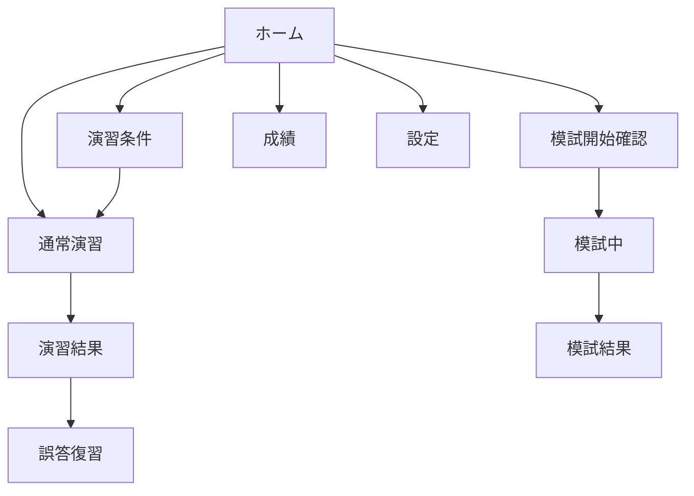

# 画面仕様書

実装イメージは `prototype/index.html` で確認できる。

## 共通レイアウト

### モバイル
- 上部：画面タイトルまたは問題進捗
- 中央：スクロール可能な内容
- 下部：ホーム、演習、模試、成績、設定の固定ナビゲーション
- 回答など重要操作がある画面は、ナビゲーションの上に固定アクション領域を置く
- iPhoneのSafe Areaを考慮する

### PC
- 最大幅1080px
- 左サイドナビゲーションまたは上部ナビゲーション
- 問題画面は読みやすさのため本文最大幅760px

---

## S01 ホーム

### 目的
現在地と次の学習行動を一目で分からせる。

### 表示
- アプリ名「A1道場」
- 今日の学習：回答数、連続学習日数
- 全体進捗：回答済み / 240問、正答率
- 主ボタン「前回の続き」または「今日の10問を始める」
- クイック開始：ランダム、誤答、未回答、お気に入り
- 苦手カテゴリ上位3件
- 次回復習対象数

### 状態
- 初回：主ボタンを「まずは10問」にする
- 途中演習あり：「前回の続き」を最優先
- 履歴なし：0%でも空白画面にしない

---

## S02 演習条件

### 表示
- 出題対象：全問、カテゴリ、未回答、誤答、お気に入り
- 系統：テクノロジ、マネジメント、ストラテジ
- カテゴリ複数選択
- 難易度：基礎、標準、応用
- 問題数：5、10、20、30、全件
- 選択肢シャッフル
- 対象問題数のリアルタイム表示
- 主ボタン「演習を始める」

### バリデーション
- 対象0問では開始不可
- 条件が矛盾した場合は理由を表示

---

## S03 通常演習・回答前

### 上部
- 戻る
- `3 / 10`
- 進捗バー
- お気に入り

### 本文
- 系統・カテゴリ・難易度チップ
- 問題文
- A～Dの選択肢カード
- 見直し用メモは初期版では任意

### 下部固定
- 「回答する」ボタン
- 未選択時は無効

### 操作
- 選択肢全体をタップ可能
- 選択変更は回答前のみ可能

---

## S04 通常演習・回答後

### 表示
- 正解：緑の「正解」表示
- 誤答：赤の「不正解」表示
- 正解選択肢に緑枠と正解ラベル
- 選択した誤答に赤枠とあなたの回答ラベル
- 解説カード
- 「覚える一行」強調カード
- カテゴリの成績ミニ表示

### 下部固定
- 「次の問題」
- 最終問題は「結果を見る」

### 規則
- 回答後は選択肢変更不可
- 色だけでなく文言を必ず表示

---

## S05 演習結果

### 表示
- 得点、正答率、回答時間
- 正解・誤答・未回答数
- カテゴリ別内訳
- 誤答問題一覧
- 「誤答だけ復習」
- 「同じ条件でもう一度」
- 「ホームへ」

---

## S06 模擬試験・開始確認

### 表示
- 30問、50分
- 試験中は解説を表示しない説明
- 途中で閉じた場合の再開説明
- 「模試を開始」

---

## S07 模擬試験中

### 上部固定
- 残り時間
- `12 / 30`
- 問題一覧ボタン

### 本文
- 問題文、選択肢
- 「見直し」トグル

### 下部
- 前へ、次へ
- 30問目では「終了確認」

### 問題一覧ドロワー
- 1～30の番号
- 回答済み、未回答、見直しを文字・記号・色で区別
- 任意の問題へ移動

### 時間
- 残り5分で橙の注意表示
- 残り1分で赤の注意表示
- 0で自動終了

---

## S08 模試結果

### 表示
- 合否目安：18/30以上を合格圏として表示。ただし公式判定ではないと明記
- 得点、正答率、未回答、所要時間
- 系統・カテゴリ別成績
- 見直し指定問題の結果
- 誤答一覧と解説
- 「誤答を復習」

---

## S09 成績

### 表示
- 全体進捗
- 直近7日回答数
- 全体正答率
- 系統別3本のバー
- 15カテゴリ一覧：回答数、正答率、状態
- 難易度別
- 模試履歴

### 状態ラベル
- 未着手
- 要復習：正答率60%未満
- 合格圏：60～79%
- 得意：80%以上かつ一定回答数

母数が少ない場合は、率だけで「得意」と判定しない。

---

## S10 設定

### 表示
- テーマ：端末設定、ライト、ダーク
- 文字サイズ：標準、大、特大
- 選択肢シャッフル
- 学習データ書き出し
- 学習データ取り込み
- 学習データ全消去
- アプリ・問題データのバージョン

### 危険操作
- 全消去は確認ダイアログ
- 確認文に消える範囲を明記

---

## 画面遷移

